# Manual de Usuario — Portal Web y Panel Administrativo RE/MAX Zona Inmobiliaria

> **Versión imprimible y corporativa:** También disponible en [Manual_de_Usuario_REMAX_Zona.pdf](Manual_de_Usuario_REMAX_Zona.pdf) y en versión web interactiva en [Manual_de_Usuario_REMAX_Zona.html](Manual_de_Usuario_REMAX_Zona.html).

---

## Control Documental

| Campo | Detalle |
|---|---|
| **Código de documento** | `MAN-USR-RZ-001` |
| **Versión** | `1.0` — Producción |
| **Fecha de emisión** | Noviembre 2026 |
| **Sistema** | Sitio Web Público y Panel Administrativo de RE/MAX Zona Inmobiliaria |
| **Cobertura** | Oficinas de Arequipa, Lima, Moquegua y Puno |
| **Público objetivo** | Visitantes/clientes, Equipo de Marketing, Administradores y Soporte Técnico |
| **Idioma / Zona horaria** | Español (Perú) / `America/Lima` |

### Historial de Revisiones

| Versión | Fecha | Responsable | Descripción |
|---|---|---|---|
| **1.0** | Noviembre 2026 | Equipo de Proyecto RE/MAX Zona | Emisión inicial completa con capturas reales del sistema, diagramas operativos, matriz de permisos, diccionario de campos y guía de seguridad 2FA. |

---

## Tabla de Contenidos

1. [Introducción, Requisitos y Convenciones](#1-introducción-requisitos-y-convenciones)
2. [Guía del Sitio Web Público](#2-guía-del-sitio-web-público)
   - [2.1 Navegación global, pie de página y botón flotante de WhatsApp](#21-navegación-global-pie-de-página-y-botón-flotante-de-whatsapp)
   - [2.2 Página de Inicio (`/`)](#22-página-de-inicio-)
   - [2.3 Página Empresa y Directorio de Agentes (`/empresa`)](#23-página-empresa-y-directorio-de-agentes-empresa)
   - [2.4 Catálogo General de Propiedades (`/propiedades`)](#24-catálogo-general-de-propiedades-propiedades)
   - [2.5 Oficinas y Catálogo por Sede (`/oficinas`)](#25-oficinas-y-catálogo-por-sede-oficinas)
   - [2.6 Página de Contacto (`/contacto`)](#26-página-de-contacto-contacto)
3. [Acceso, Seguridad y Roles del Panel Administrativo](#3-acceso-seguridad-y-roles-del-panel-administrativo)
   - [3.1 Inicio de sesión y Verificación en Dos Pasos (2FA)](#31-inicio-de-sesión-y-verificación-en-dos-pasos-2fa-adminlogin)
   - [3.2 Roles y Matriz de Permisos](#32-roles-y-matriz-de-permisos)
4. [Módulos Operativos Compartidos (Administrador y Marketing)](#4-módulos-operativos-compartidos-administrador-y-marketing)
   - [4.1 Gestión de Propiedades (`/admin/propiedades`)](#41-gestión-de-propiedades-adminpropiedades)
   - [4.2 Gestión de Agentes (`/admin/agentes`)](#42-gestión-de-agentes-adminagentes)
   - [4.3 Gestión del Ranking Mensual (`/admin/ranking-actual`)](#43-gestión-del-ranking-mensual-adminranking-actual)
5. [Módulos Exclusivos del Administrador](#5-módulos-exclusivos-del-administrador)
   - [5.1 Portada Principal (`/admin/portada`)](#51-portada-principal-adminportada)
   - [5.2 Gestión de Oficinas (`/admin/oficinas`)](#52-gestión-de-oficinas-adminoficinas)
   - [5.3 Historial de Rankings Mensuales (`/admin/historial-rankings`)](#53-historial-de-rankings-mensuales-adminhistorial-rankings)
   - [5.4 Información Global de Contacto (`/admin/configuracion-contacto`)](#54-información-global-de-contacto-adminconfiguracion-contacto)
   - [5.5 Gestión de Usuarios y Roles (`/admin/usuarios`)](#55-gestión-de-usuarios-y-roles-adminusuarios)
6. [Mi Cuenta, Apariencia y Seguridad Personal](#6-mi-cuenta-apariencia-y-seguridad-personal)
   - [6.1 Perfil de Usuario](#61-perfil-de-usuario-settingsprofile)
   - [6.2 Apariencia del Panel (Modo Claro / Modo Oscuro)](#62-apariencia-del-panel-modo-claro--modo-oscuro-settingsappearance)
   - [6.3 Seguridad: Contraseña y 2FA](#63-seguridad-contraseña-y-2fa-settingssecurity)
7. [Preguntas Frecuentes y Solución de Problemas](#7-preguntas-frecuentes-y-solución-de-problemas)
8. [Glosario de Términos y Anexo Técnico](#8-glosario-de-términos-y-anexo-técnico)

---

## 1. Introducción, Requisitos y Convenciones

### 1.1 Propósito del sistema
La plataforma web de **RE/MAX Zona Inmobiliaria** integra dos entornos sobre una misma base de datos en tiempo real:

- **Sitio Web Público:** Permite a los clientes consultar propiedades con filtros instantáneos, explorar sedes regionales (**Arequipa, Lima, Moquegua y Puno**), conocer a los vendedores estrella del mes, ubicar a los agentes inmobiliarios y contactar directamente por teléfono, correo o WhatsApp.
- **Panel Administrativo (Intranet):** Consola privada protegida por autenticación, control de roles (`ADMINISTRADOR` y `MARKETING`) y autenticación opcional en dos pasos (2FA), para gestionar todo el contenido del portal sin requerir conocimientos técnicos.

### 1.2 Requisitos técnicos y accesibilidad (WCAG 2.1 AA)
- **Navegadores compatibles:** Versiones actualizadas de Google Chrome, Microsoft Edge, Mozilla Firefox y Safari (computadora, tableta y móvil).
- **JavaScript y Cookies:** Habilitados para filtros reactivos, vistas previas de imágenes y sesión administrativa.
- **Accesibilidad:** Navegación completa mediante teclado (`Tab`, `Shift + Tab`, `Enter`, `Espacio`), enlace rápido *«Saltar al contenido»*, indicadores visibles de enfoque, contraste verificado y compatibilidad con lectores de pantalla.
- **Optimización multimedia automática:** Toda fotografía cargada desde el panel (JPG, JPEG, PNG o WebP hasta 4 MB) genera automáticamente una versión optimizada en **WebP** conservando intacto el original.

### 1.3 Convenciones visuales
- `★` / `☆` — Destacar o quitar una propiedad de la página de Inicio.
- `✎` — Abrir el panel de edición del registro seleccionado.
- `⌫` — Eliminar registro (previa confirmación explícita).
- `✓` / `○` — Activar o inactivar la visibilidad pública de un agente con un clic.

---

## 2. Guía del Sitio Web Público

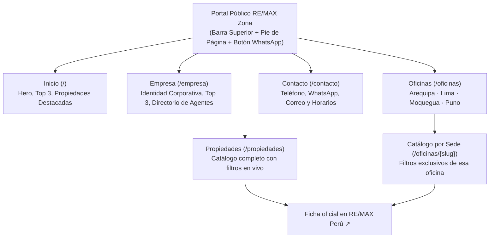

### 2.1 Navegación global, pie de página y botón flotante de WhatsApp
Todas las páginas públicas comparten:
1. **Encabezado institucional:** Logotipo **RE/MAX Zona** (vuelve a Inicio) y enlaces a **Inicio**, **Empresa**, **Propiedades**, **Oficinas** y **Contacto**.
2. **Pie de página (Footer):** Nombre comercial, dirección/cobertura, teléfono (`tel:`), correo (`mailto:`), acceso a *WhatsApp directo* y horarios de lunes a viernes y sábados.
3. **Botón flotante «💬 WhatsApp»:** Permanente en la esquina inferior derecha para atención inmediata.

---

### 2.2 Página de Inicio (`/`)
Organizada en cuatro secciones:
1. **Portada Principal (Hero):** Fotografía panorámica administrable, título *«Encuentra tu propiedad ideal»* y botón **Ver propiedades**.
2. **Nuestros Destacados (Ranking Mensual):** Muestra el podio del mes (**1.er Puesto**, **2.º Puesto** y **3.er Puesto**) con foto, nombre completo y enlace a WhatsApp; o el aviso *«Ranking mensual en actualización...»* si el período aún no ha sido publicado.
3. **Propiedades Destacadas:** Muestra únicamente inmuebles activos marcados con estrella (`★`), con enlace **Más información →** a su ficha oficial en RE/MAX Perú.
4. **Trabaja con nosotros:** Botón **Postular por WhatsApp**.

*Figura 1. Portada principal (Hero) de la página de Inicio con barra de navegación institucional y botón flotante de WhatsApp.*

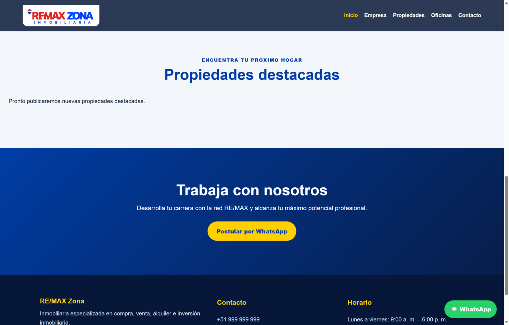
*Figura 2. Sección de Propiedades Destacadas y bloque inferior de postulación «Trabaja con nosotros».*

---

### 2.3 Página Empresa y Directorio de Agentes (`/empresa`)
Presenta **Quiénes somos**, **Identidad corporativa** (Misión, Visión y Valores: Transparencia, Confianza, Ética profesional y Compromiso con el cliente), **Nuestros destacados** y el directorio alfabético **Nuestros agentes inmobiliarios** (foto, biografía, Celular, WhatsApp y correo).

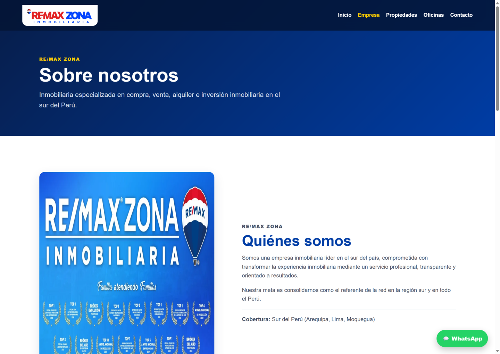
*Figura 3. Página Empresa: sección institucional «Quiénes somos» e identidad corporativa.*

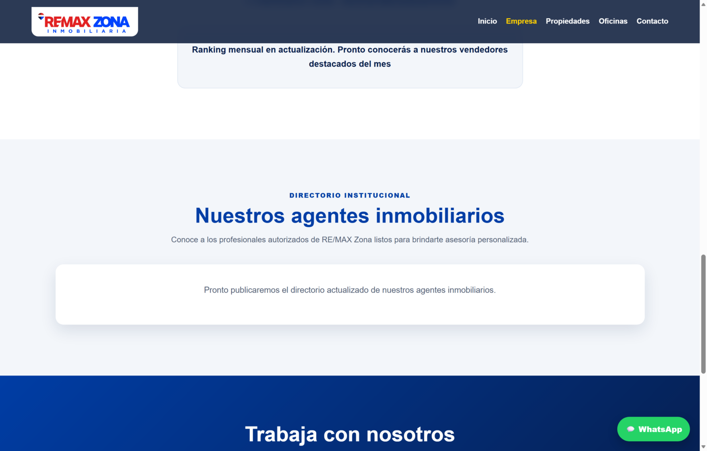
*Figura 4. Sección inferior de Empresa con el directorio público de agentes inmobiliarios.*

---

### 2.4 Catálogo General de Propiedades (`/propiedades`)
Ofrece filtrado reactivo sincronizado con la URL (permite copiar y compartir búsquedas filtradas):
- **Buscar propiedad o zona:** Búsqueda libre por nombre del proyecto o ubicación.
- **Ubicación:** Desplegable dinámico según las ubicaciones activas.
- **Moneda:** Todas las monedas, Soles (`S/`) o Dólares (`$`).
- **Limpiar filtros:** Restablece el catálogo completo con un clic.

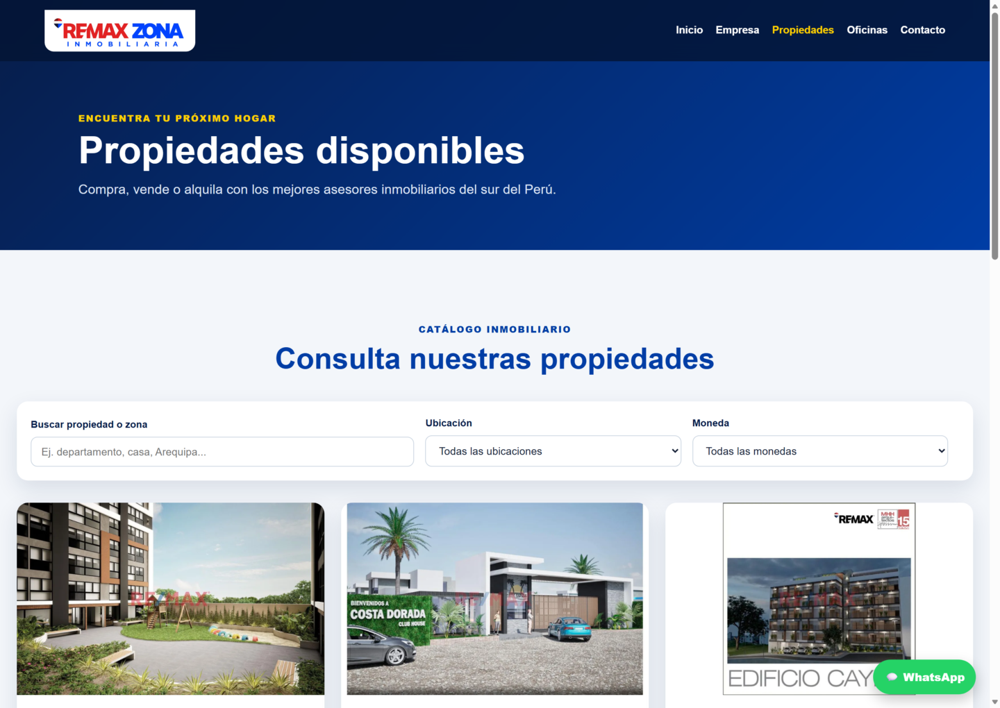
*Figura 5. Catálogo General de Propiedades con barra de filtros por texto, ubicación y moneda.*

---

### 2.5 Oficinas y Catálogo por Sede (`/oficinas`)
Muestra las **cuatro sedes oficiales**: **Arequipa**, **Lima**, **Moquegua** y **Puno**, con sus datos de contacto individuales (cuando estén configurados), enlace a Google Maps y botón **Ver propiedades**, que dirige a `/oficinas/{slug}` con el catálogo y filtros dedicados de esa sede.

*Figura 6. Directorio de las cuatro oficinas oficiales de RE/MAX Zona.*

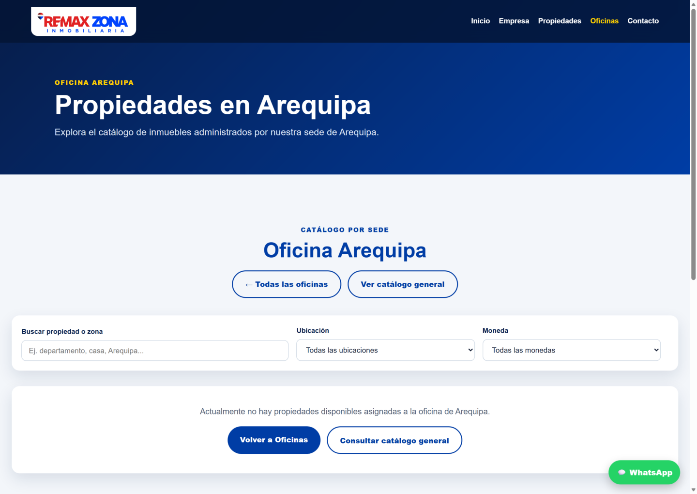
*Figura 7. Catálogo individual de propiedades filtrado por sede (ejemplo: `/oficinas/arequipa`).*

---

### 2.6 Página de Contacto (`/contacto`)
Presenta las tarjetas de **Teléfono y WhatsApp**, **Correo electrónico**, **Dirección y cobertura**, **Horario de atención** y el bloque **Trabaja con nosotros**.

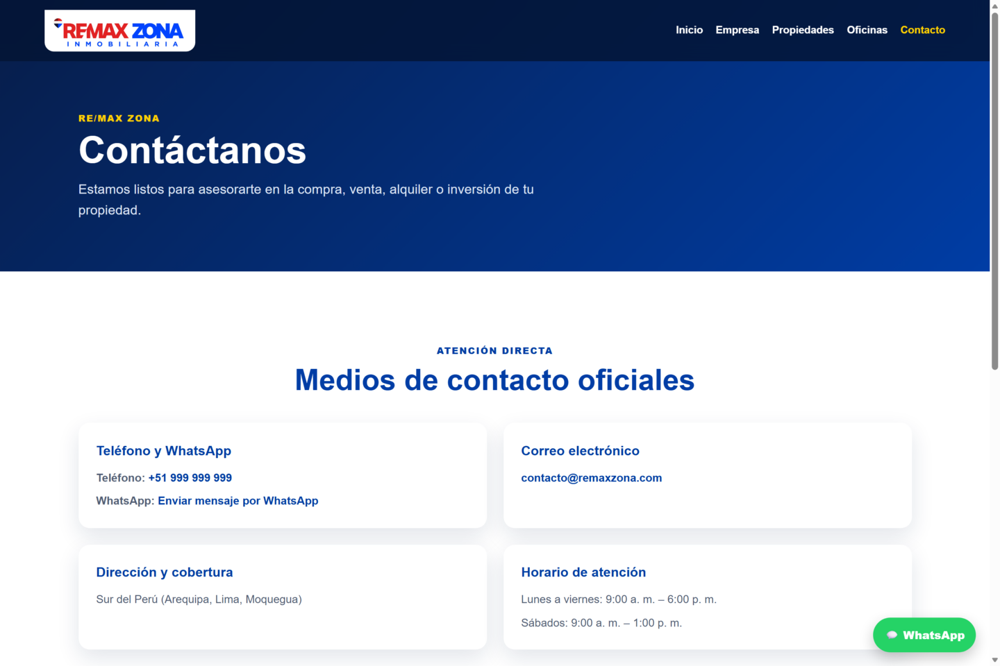
*Figura 8. Página de Contacto con medios oficiales de atención y horarios configurados.*

---

## 3. Acceso, Seguridad y Roles del Panel Administrativo

### 3.1 Inicio de sesión y Verificación en Dos Pasos (2FA) (`/admin/login`)

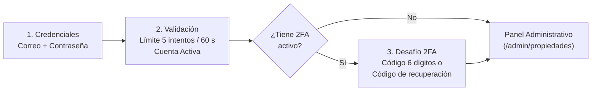

1. Ingrese a `/admin/login`, escriba su **Correo electrónico** y **Contraseña** y pulse **Iniciar sesión**.
2. Si su cuenta tiene **2FA** activo, ingrese el **código de 6 dígitos** de su aplicación autenticadora (Google Authenticator, Microsoft Authenticator o Authy), o pulse **Usar un código de recuperación** en caso de emergencia.
3. **Protección contra fuerza bruta:** Tras 5 intentos fallidos consecutivos, el acceso se bloquea temporalmente por **60 segundos**.

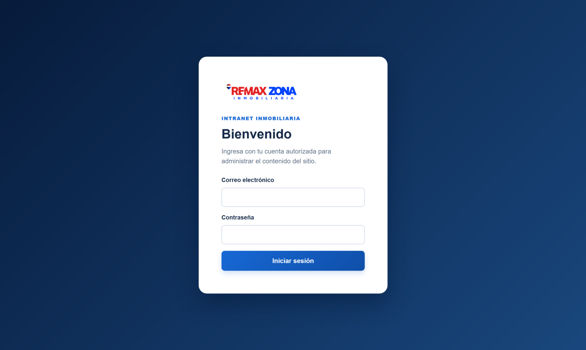
*Figura 9. Pantalla de acceso a la Intranet Inmobiliaria (`/admin/login`).*

---

### 3.2 Roles y Matriz de Permisos

| Módulo del Panel | Ruta URL | ADMINISTRADOR | MARKETING | Operaciones |
|---|---|:---:|:---:|---|
| **Propiedades** | `/admin/propiedades` | Permitido | Permitido | Crear, editar, destacar, eliminar |
| **Agentes** | `/admin/agentes` | Permitido | Permitido | Crear, editar, activar/inactivar, eliminar |
| **Ranking Mensual** | `/admin/ranking-actual` | Permitido | Permitido | Registrar 3 puestos y publicar (días 1–3) |
| **Portada Principal** | `/admin/portada` | Permitido | Restringido | Cambiar fotografía Hero de Inicio |
| **Oficinas** | `/admin/oficinas` | Permitido | Restringido | Editar datos y foto de las 4 sedes |
| **Historial de Rankings** | `/admin/historial-rankings` | Permitido | Restringido | Consulta histórica en solo lectura |
| **Contacto Global** | `/admin/configuracion-contacto` | Permitido | Restringido | Teléfonos, WhatsApp, correos y horarios |
| **Usuarios y Roles** | `/admin/usuarios` | Permitido | Restringido | Crear, editar y suspender cuentas |
| **Mi Cuenta y Seguridad** | `/settings/profile` | Permitido | Permitido | Perfil, Modo Claro/Oscuro, Clave y 2FA |

> Cualquier intento de acceso directo por URL de un usuario `MARKETING` a módulos de `ADMINISTRADOR` es bloqueado con error **HTTP 403**.

---

## 4. Módulos Operativos Compartidos (Administrador y Marketing)

### 4.1 Gestión de Propiedades (`/admin/propiedades`)
Interfaz maestro-detalle con buscador en tiempo real por nombre o ubicación.

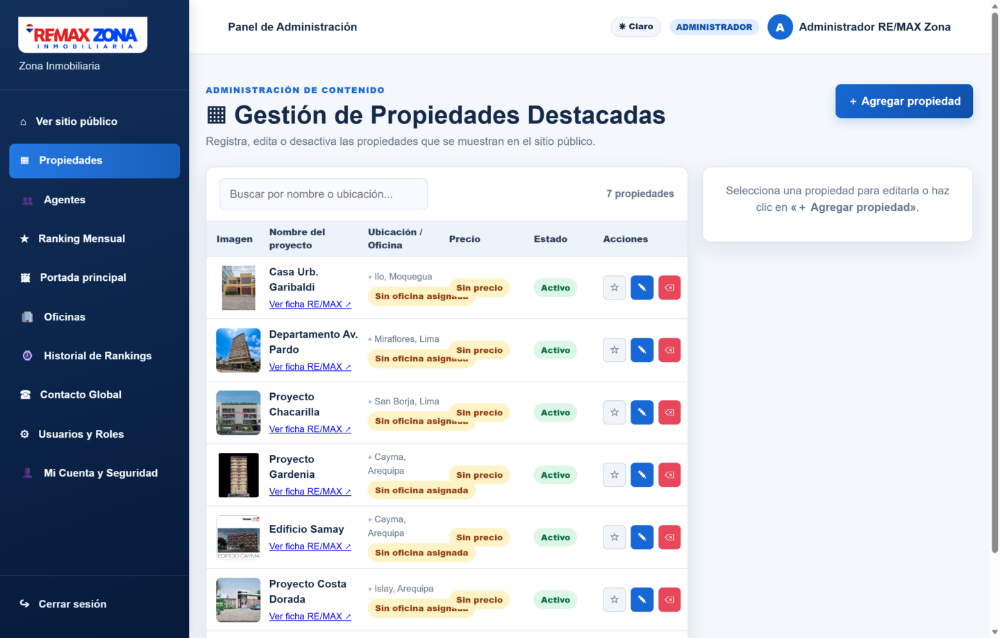
*Figura 10. Listado principal de Gestión de Propiedades con buscador, oficina, estado y acciones rápidas.*

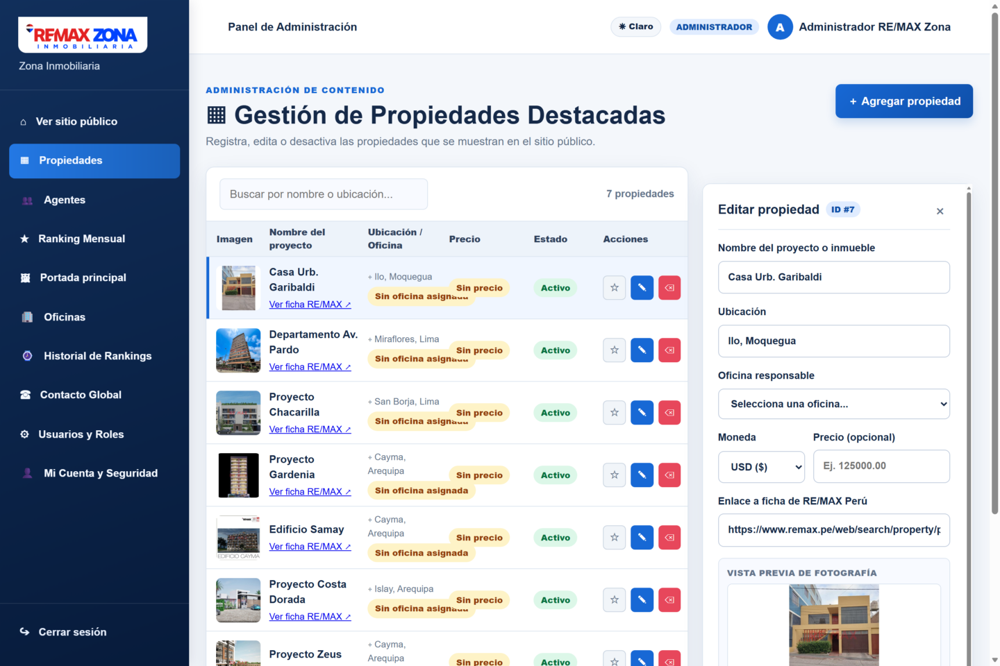
*Figura 11. Panel lateral maestro-detalle de edición de propiedad con vista previa de fotografía.*

#### Diccionario de campos y validaciones
| Campo | Exigencia | Regla de validación |
|---|---|---|
| **Nombre del proyecto o inmueble** | Obligatorio | Máx. 140 caracteres. |
| **Ubicación** | Obligatorio | Máx. 140 caracteres. Alimenta el desplegable público. |
| **Oficina responsable** | Obligatorio | Arequipa, Lima, Moquegua o Puno. |
| **Moneda / Precio** | Opcional | Si se registra precio (`>= 0`), la moneda (`USD` o `PEN`) es obligatoria. |
| **Enlace RE/MAX Perú** | Obligatorio | URL válida que inicie con `http://` o `https://` (máx. 500 caracteres). |
| **Fotografía** | Obligatoria al crear | Opcional al editar. JPG, JPEG, PNG o WEBP, máx. **4 MB** (WebP automático 1200 px). |
| **Visible en el sitio público** | Casilla | Controla visibilidad pública (`Activo` / `Inactivo`). |

- **Acciones:** `★/☆` destaca en la página de Inicio (requiere estado `Activo`), `✎` edita y `⌫` elimina previa confirmación.

---

### 4.2 Gestión de Agentes (`/admin/agentes`)
Administra el directorio institucional publicado en `/empresa`.

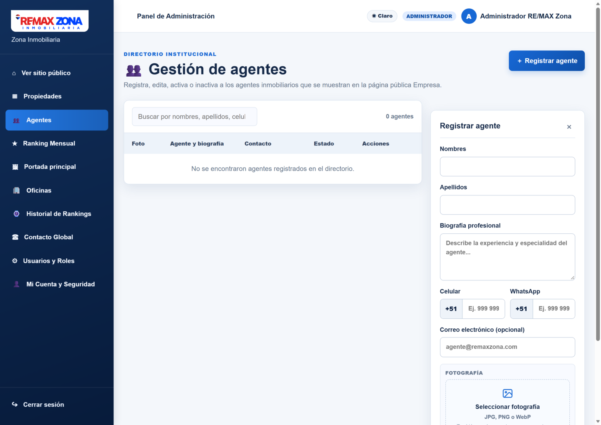
*Figura 12. Módulo Gestión de Agentes con formulario de registro y zona interactiva de carga fotográfica.*

1. Pulse **＋ Registrar agente**.
2. Complete **Nombres** (máx. 100), **Apellidos** (máx. 100), **Biografía profesional** (máx. 1000), **Celular** (`+51`), **WhatsApp** (`+51`) y opcionalmente **Correo electrónico**.
3. Cargue la **Fotografía** (JPG, PNG o WebP hasta 4 MB; optimizada a WebP 600 px) haciendo **clic**, **arrastrando y soltando** o **pegando con `Ctrl + V`**.
4. Use **✓ / ○** en la tabla para activar o inactivar instantáneamente la visibilidad pública de un agente.

---

### 4.3 Gestión del Ranking Mensual (`/admin/ranking-actual`)

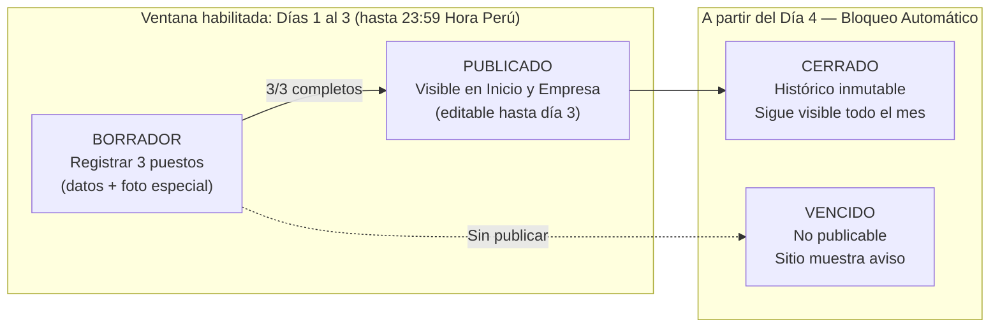

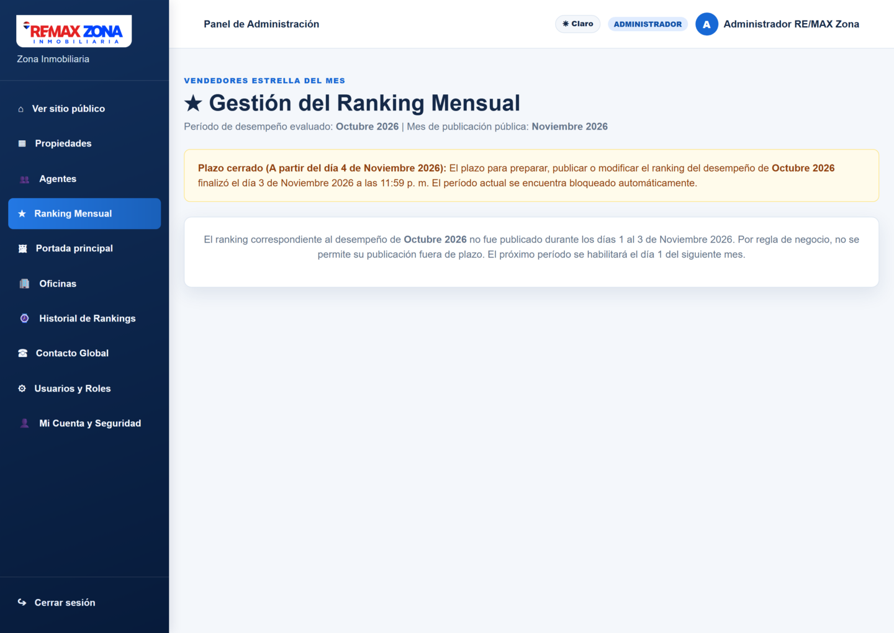
*Figura 13. Vista del módulo Gestión del Ranking Mensual (ejemplo en estado bloqueado a partir del día 4).*

- **Reglas clave:**
  - Evalúa el desempeño del **mes calendario anterior** y se publica durante el **mes actual**.
  - Solo editable los **días 1, 2 y 3 del mes hasta las 11:59 p. m. (`America/Lima`)**.
  - Consta de **3 puestos fijos e independientes** (1.er, 2.º y 3.er puesto) con código interno automático (`PART-...`).
  - **Celular único por período:** No se permite repetir número de celular entre puestos. Si coinciden nombres y apellidos, el sistema muestra una advertencia no bloqueante de posible homónimo.
  - Al completar los 3 puestos (`3 / 3`), pulse **Publicar Ranking en el Sitio Público**.

---

## 5. Módulos Exclusivos del Administrador

### 5.1 Portada Principal (`/admin/portada`)
Actualiza la fotografía Hero de Inicio (`/`). Acepta JPG, JPEG, PNG o WEBP hasta **4 MB** y genera copia WebP hasta **1920 px** de ancho.

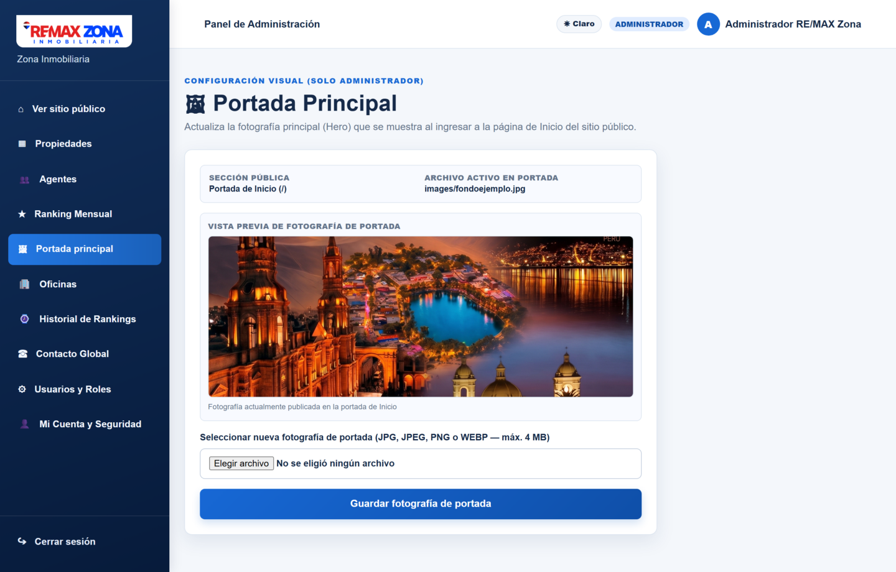
*Figura 14. Módulo Portada Principal con vista previa activa y selector de nueva fotografía.*

---

### 5.2 Gestión de Oficinas (`/admin/oficinas`)
Edita los datos individuales y fotografía de las **4 oficinas oficiales fijas** (Arequipa, Lima, Moquegua y Puno). El código oficial y la ruta `/oficinas/{slug}` son inmutables.

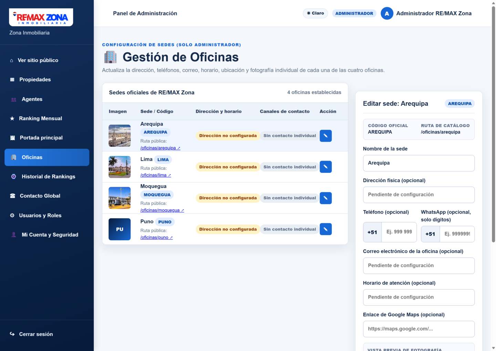
*Figura 15. Gestión de Oficinas mostrando las 4 sedes oficiales y el panel de edición lateral.*

---

### 5.3 Historial de Rankings Mensuales (`/admin/historial-rankings`)
Consulta en modo **solo lectura** los rankings históricos (`PUBLICADO` y `CERRADO`) filtrables por **Mes de desempeño** y **Año de desempeño**, conservando intactos los datos y fotografías de cada período.

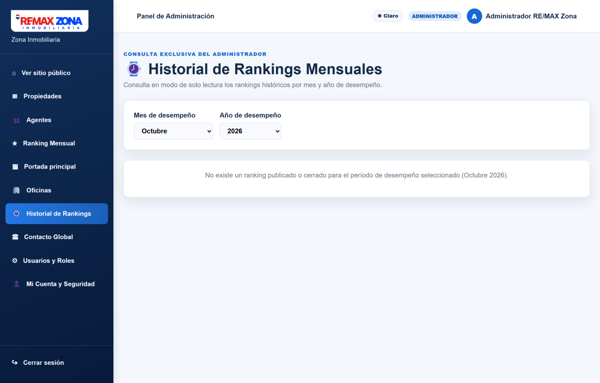
*Figura 16. Consulta del Historial de Rankings Mensuales en modo de solo lectura.*

---

### 5.4 Información Global de Contacto (`/admin/configuracion-contacto`)
Configura el **Nombre comercial**, **Teléfono visible**, **WhatsApp general**, **WhatsApp de postulaciones**, **Correo**, **Dirección/cobertura** y **Horarios (Lunes–Viernes y Sábados)** replicados en todo el portal público.

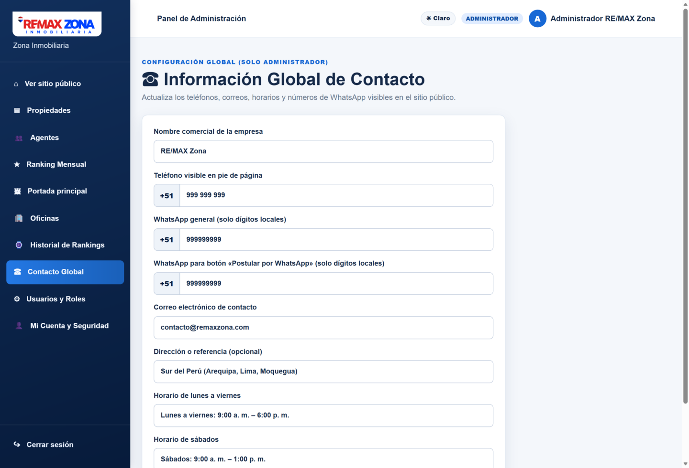
*Figura 17. Formulario de Información Global de Contacto con prefijos +51 automatizados.*

---

### 5.5 Gestión de Usuarios y Roles (`/admin/usuarios`)
Crea y edita cuentas con rol `ADMINISTRADOR` o `MARKETING` (contraseña mínimo 8 caracteres; opcional al editar). La casilla **Cuenta activa** permite suspender accesos inmediatamente. Por seguridad, un Administrador no puede desactivar su propia cuenta ni retirarse su propio rol.

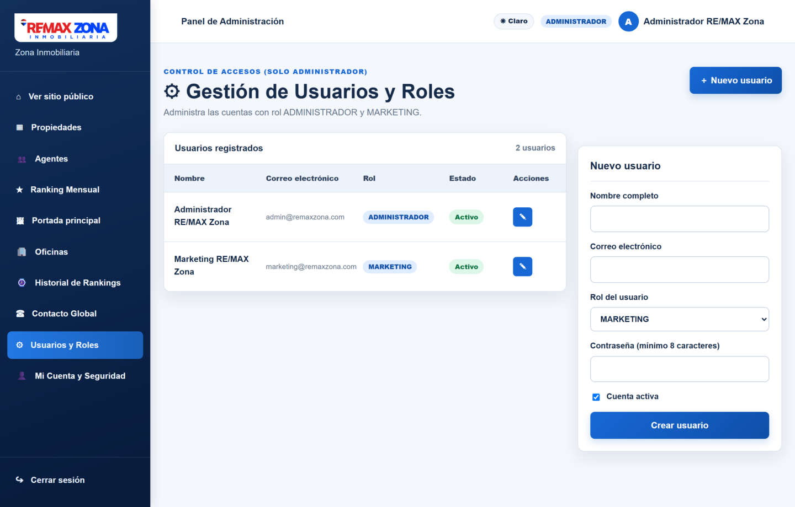
*Figura 18. Módulo Gestión de Usuarios y Roles.*

---

## 6. Mi Cuenta, Apariencia y Seguridad Personal

Accesible para `ADMINISTRADOR` y `MARKETING` desde **👤 Mi Cuenta y Seguridad**.

### 6.1 Perfil de Usuario (`/settings/profile`)
Permite actualizar el **Nombre completo** y el **Correo electrónico de acceso** (modificar el correo exige confirmar la contraseña actual).

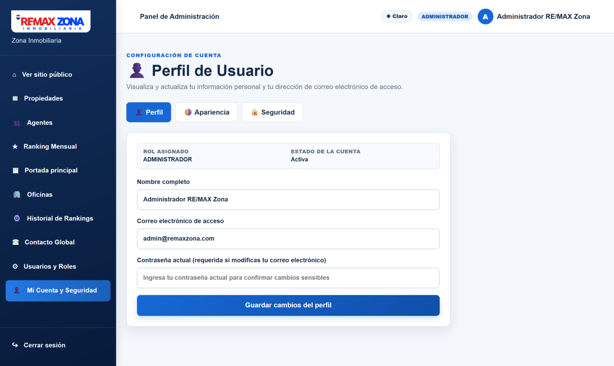
*Figura 19. Pestaña Perfil de Usuario con metadatos de rol y actualización segura de correo.*

---

### 6.2 Apariencia del Panel (Modo Claro / Modo Oscuro) (`/settings/appearance`)
Permite elegir entre **Modo claro** (`☀`) y **Modo oscuro** (`🌙`). La preferencia se guarda en la cuenta personal y se aplica automáticamente en futuros inicios de sesión.

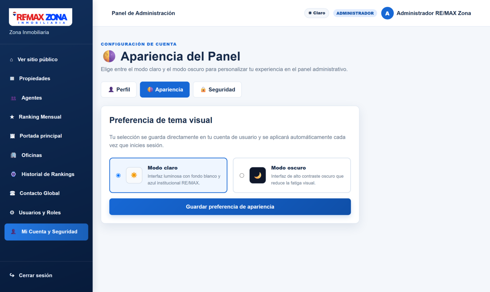
*Figura 20. Selector de apariencia del panel en Modo Claro.*

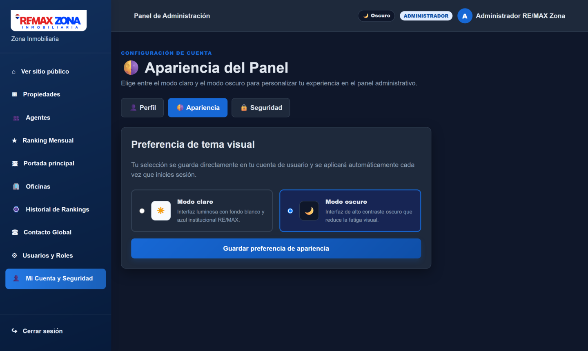
*Figura 21. Vista del panel administrativo con el Modo Oscuro activado.*

---

### 6.3 Seguridad: Contraseña y 2FA (`/settings/security`)
- **Actualizar contraseña:** Requiere contraseña actual, nueva contraseña (mínimo 8 caracteres) y confirmación.
- **Autenticación de Dos Factores (2FA):** Ingrese su contraseña actual → pulse **Habilitar autenticación de dos factores (2FA)** → escanee el código QR (o copie la clave manual) en Google Authenticator, Microsoft Authenticator o Authy → ingrese el código de 6 dígitos → pulse **Confirmar y activar 2FA** y guarde sus **códigos de recuperación**.

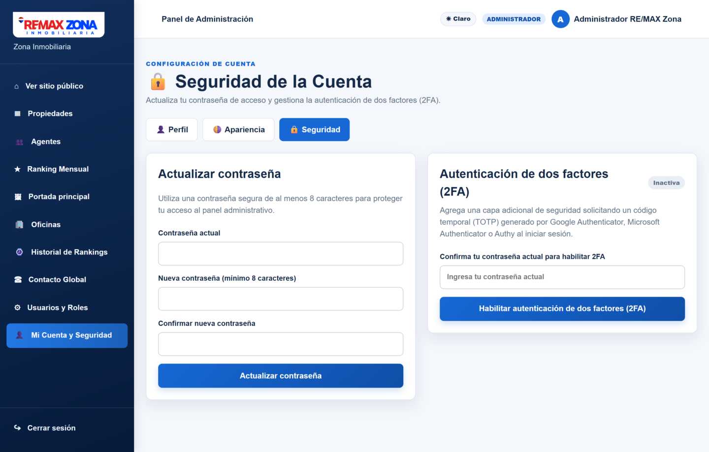
*Figura 22. Pestaña Seguridad de la Cuenta: cambio de contraseña y configuración de 2FA.*

---

## 7. Preguntas Frecuentes y Solución de Problemas

| Situación | Causa probable | Solución |
|---|---|---|
| **«Demasiados intentos. Intenta nuevamente en X segundos»** | 5 intentos fallidos consecutivos de login o 2FA. | Espere 60 segundos y reintente verificando contraseña o reloj del móvil (2FA). |
| **Propiedad activa no aparece en Inicio** | Solo aparecen propiedades **Activas** y **Destacadas (`★`)**. | Pulse la estrella (`☆`) en la fila correspondiente en *Propiedades*. |
| **Propiedad no aparece en su oficina** | Falta asignar *Oficina responsable* o está inactiva. | Edite (`✎`), seleccione la sede correcta y marque *Visible en el sitio público*. |
| **No permite guardar o publicar el Ranking Mensual** | Fuera de ventana (días 1–3 hora Perú), puestos incompletos o celular repetido. | Registre los 3 puestos con celulares únicos dentro de los días 1 al 3 hasta las 23:59. |
| **Error al subir fotografía** | Supera los **4 MB** o formato no admitido. | Use **JPG, JPEG, PNG o WEBP** con peso menor a 4 MB. |
| **Sin acceso al teléfono con app 2FA** | Teléfono extraviado o sin batería. | Use **Usar un código de recuperación** con uno de sus códigos de emergencia. |
| **No veo Portada, Oficinas, Historial, Contacto o Usuarios** | Cuenta con rol `MARKETING`. | Son módulos exclusivos del rol `ADMINISTRADOR`. |

---

## 8. Glosario de Términos y Anexo Técnico

### 8.1 Glosario
- **2FA / TOTP:** Autenticación de dos factores mediante códigos numéricos temporales de 6 dígitos que rotan cada 30 segundos.
- **Hero / Portada:** Fotografía panorámica principal al inicio de la portada pública (`/`).
- **Propiedad Destacada:** Inmueble activo marcado con estrella (`★`) para exhibirse en la página de Inicio.
- **Slug:** Identificador amigable en la URL de cada oficina (`arequipa`, `lima`, `moquegua`, `puno`).
- **Snapshot histórico:** Copia independiente de nombre, celular y fotografía congelada para cada período del Ranking Mensual.
- **WebP:** Formato moderno de compresión de imágenes generado automáticamente por el sistema.

### 8.2 Anexo de mantenimiento técnico
- `GET /salud` — Endpoint JSON de verificación de salud (aplicación, MySQL, almacenamiento; `Cache-Control: no-store`).
- `GET /sitemap.xml` — Mapa del sitio XML dinámico para SEO.
- `php artisan sistema:verificar-salud` — Monitoreo programado cada 5 minutos (`storage/logs/disponibilidad.log`).
- `php artisan sistema:respaldar` — Respaldo diario (02:30) de BD + `multimedia.zip` + `manifiesto.json` SHA-256 en `storage/app/private/respaldos/`.
- `php artisan sistema:verificar-respaldo {directorio}` — Verificación no destructiva de integridad SHA-256.
- `php artisan sistema:optimizar-imagenes` — Optimización WebP por lotes conservando originales.
