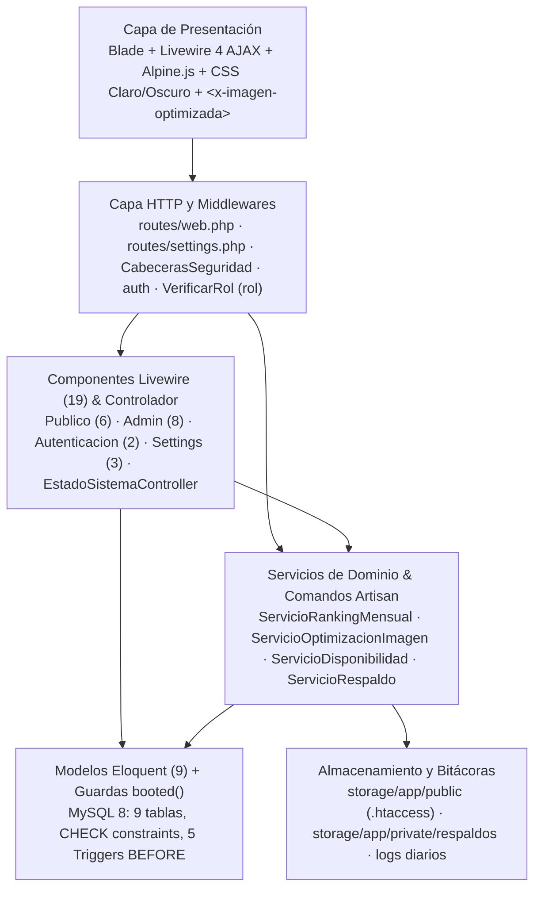
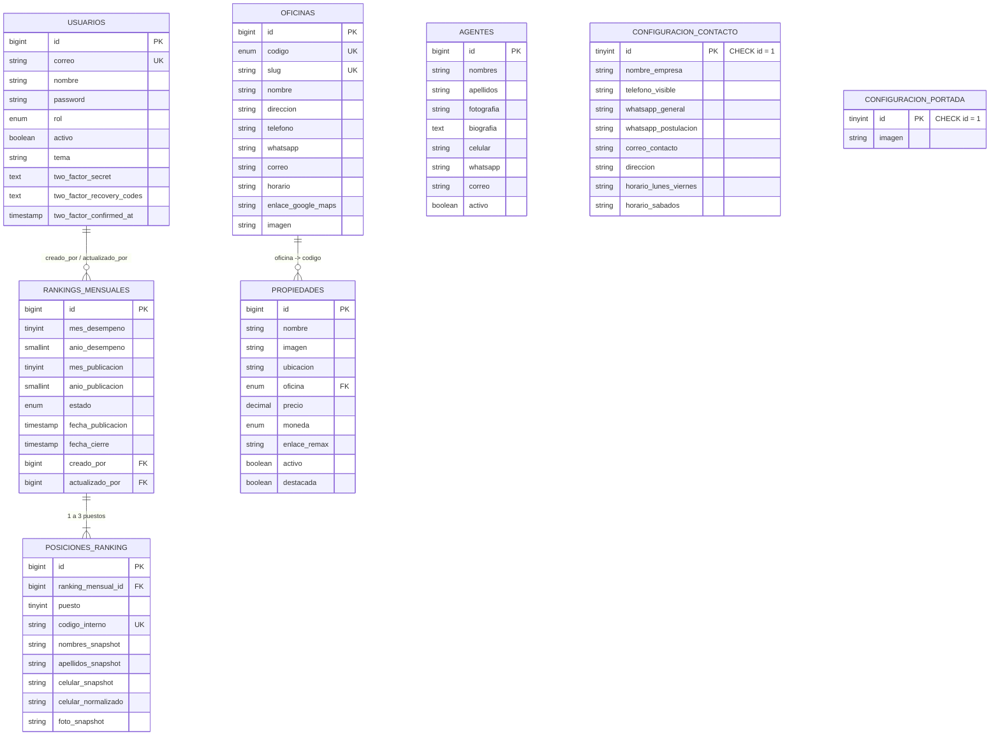

# Manual Técnico del Sistema — RE/MAX Zona Inmobiliaria

> **Versiones corporativas:** Disponible también en [Manual_Tecnico_REMAX_Zona.pdf](Manual_Tecnico_REMAX_Zona.pdf) y [Manual_Tecnico_REMAX_Zona.html](Manual_Tecnico_REMAX_Zona.html).  
> **Guía complementaria para defensa del código:** [GUIA_SUSTENTACION_CODIGO.md](GUIA_SUSTENTACION_CODIGO.md) / [Guia_Sustentacion_Codigo_REMAX_Zona.pdf](Guia_Sustentacion_Codigo_REMAX_Zona.pdf).

---

## Control Documental

| Campo | Detalle |
|---|---|
| **Código** | `MAN-TEC-RZ-001` |
| **Versión** | `1.0` — Producción |
| **Fecha de emisión** | Noviembre 2026 |
| **Stack principal** | PHP `^8.3` (GD), Laravel `^13.17`, Livewire `^4.1`, Laravel Fortify `^1.37.2`, MySQL 8 / MariaDB |
| **Calidad y pruebas** | PHPUnit 12 (36 pruebas / 157 aserciones), Larastan/PHPStan, Laravel Pint |

---

## 1. Arquitectura del Sistema y Stack Tecnológico

La plataforma sigue una arquitectura **monolítica modular por capas** basada en **componentes Livewire 4 de página completa** (`#[Layout(...)]`), donde las rutas web apuntan directamente a clases Livewire para el manejo de estado, validación y renderizado reactivo. El único controlador HTTP tradicional es `EstadoSistemaController` (`__invoke`) para el endpoint JSON sin estado `GET /salud`. La lógica compleja de dominio se desacopla en `app/Services/`.



### Decisiones globales en `app/Providers/AppServiceProvider.php`
- `Fortify::ignoreRoutes()` — Desactiva rutas genéricas en inglés para controlar `/admin/login` y cerrar auto-registro público.
- `Date::use(CarbonImmutable::class)` — Fechas inmutables en todo el sistema.
- `DB::prohibitDestructiveCommands(app()->isProduction())` — Bloquea comandos destructivos (`migrate:fresh`, `db:wipe`) en producción.
- `URL::forceScheme('https')` — Fuerza HTTPS en producción cuando `APP_URL` usa `https://`.

---

## 2. Estructura de Directorios y Catálogo de Clases

| Directorio / Archivo | Responsabilidad |
|---|---|
| `app/Livewire/Publico/` | `PaginaInicio`, `PaginaEmpresa`, `PaginaPropiedades`, `PaginaOficinas`, `PaginaPropiedadesOficina`, `PaginaContacto`. |
| `app/Livewire/Admin/` | `GestionPropiedades`, `GestionAgentes`, `GestionRankingActual`, `GestionPortada`, `GestionOficinas`, `HistorialRankings`, `GestionContacto`, `GestionUsuarios`. |
| `app/Livewire/Autenticacion/` | `IniciarSesion` (login + `RateLimiter` + desafío 2FA) y `ConfirmarPassword`. |
| `app/Livewire/Settings/` | `Profile`, `Appearance` (tema claro/oscuro) y `Security` (contraseña + ciclo 2FA Fortify). |
| `app/Models/` | `Usuario`, `Propiedad`, `Oficina`, `Agente`, `Vendedor`, `RankingMensual`, `PosicionRanking`, `ConfiguracionContacto`, `ConfiguracionPortada`. |
| `app/Services/` | `ServicioRankingMensual`, `ServicioOptimizacionImagen`, `ServicioDisponibilidad`, `ServicioRespaldo`. |
| `app/Http/Middleware/` | `CabecerasSeguridad` (global) y `VerificarRol` (alias `rol`). |
| `app/Http/Controllers/` | `EstadoSistemaController` (`GET /salud`). |
| `app/Console/Commands/` | `VerificarSaludSistema`, `RespaldarSistema`, `VerificarRespaldo`, `OptimizarImagenes`. |
| `app/Support/TelefonoPeru.php` | Normalización de teléfonos peruanos (`+51` visible y `51...` para `wa.me`). |
| `bootstrap/app.php` | Registro de rutas, middlewares y reporte crítico de `QueryException`/`PDOException` al canal `disponibilidad`. |

---

## 3. Diseño de Base de Datos (ERD, Restricciones CHECK y Triggers MySQL)



### Integridad a nivel de motor MySQL / MariaDB
- **CHECK Constraints:**
  - `chk_propiedades_precio_moneda`: Precio y moneda deben ser ambos nulos o ambos válidos (`precio >= 0`, `moneda IN ('PEN','USD')`).
  - `chk_oficinas_codigo_slug`: Correspondencia exacta entre `codigo` y `slug` de las 4 sedes oficiales.
  - `chk_configuracion_unica` / `chk_configuracion_portada_unica`: Garantiza patrón Singleton (`id = 1`).
  - `chk_ranking_meses` y `chk_ranking_sucesion`: Garantiza sucesión exacta `mes_desempeno → mes_publicacion` (incluyendo diciembre → enero).
  - `chk_posicion_puesto`: Solo permite puestos `1`, `2` o `3`.
- **5 Triggers MySQL (`BEFORE`):**
  - `trg_rankings_bloqueo_update` / `trg_rankings_bloqueo_delete` (`SQLSTATE '45000'` si `estado` es `CERRADO`/`VENCIDO` o al intentar borrar publicados/históricos).
  - `trg_posiciones_bloqueo_insert` / `update` / `delete` (impide alterar posiciones cuyo ranking padre está `CERRADO` o `VENCIDO`).
- **Migración 13 (`0001_01_01_000013_adaptar_posiciones_ranking_independiente.php`):** Evolucionó `posiciones_ranking` a entidad independiente (`vendedor_id` nullable, `codigo_interno` único `PART-...`, `celular_normalizado` único por período) preservando registros históricos previos.

---

## 4. Enrutamiento, Middlewares y Ciclo HTTP

- **Middleware Global (`bootstrap/app.php`):** `CabecerasSeguridad` aplica CSP, `X-Frame-Options: SAMEORIGIN`, `X-Content-Type-Options: nosniff`, `Referrer-Policy`, `Permissions-Policy`, `X-Permitted-Cross-Domain-Policies` y HSTS (en HTTPS/producción).
- **Middleware de Roles (`VerificarRol`, alias `rol`):** Si el usuario autenticado fue desactivado (`activo = false`), cierra sesión (`Auth::logout()`), invalida sesión y regenera token CSRF. Si no tiene el rol requerido, lanza `abort(403)`.
- **Grupos de rutas (`routes/web.php` y `routes/settings.php`):**
  - Público: `/`, `/empresa`, `/propiedades`, `/oficinas`, `/oficinas/{oficina}`, `/contacto`, `/salud`, `/sitemap.xml`.
  - Autenticación: `GET /admin/login` (`guest`), `POST /admin/logout` (`auth`).
  - Compartidos (`auth`, `rol:ADMINISTRADOR,MARKETING`): `/admin/propiedades`, `/admin/agentes`, `/admin/ranking-actual`, `/settings/profile`, `/settings/appearance`, `/settings/security` (+ `password.confirm`).
  - Exclusivos (`auth`, `rol:ADMINISTRADOR`): `/admin/portada`, `/admin/oficinas`, `/admin/historial-rankings`, `/admin/configuracion-contacto`, `/admin/usuarios`.

---

## 5. Lógica de Negocio Crítica y Servicios de Dominio

1. **Concurrencia en `ServicioRankingMensual`:** Usa `DB::transaction()` + `lockForUpdate()` en guardado, publicación y cierre de estados vencidos; rollback de archivos subidos en `catch (Throwable)` y limpieza de imágenes reemplazadas solo post-commit (`limpiarFotografiasReemplazadasPostCommit`).
2. **Inmutabilidad en `RankingMensual::booted()` y `PosicionRanking::booted()`:** Bloquea escrituras fuera de los días 1–3 (`America/Lima`) o en estados `CERRADO`/`VENCIDO`, admitiendo únicamente `esTransicionInternaDeCierre()`.
3. **Optimización WebP nativa (`ServicioOptimizacionImagen`):** Extensión PHP GD (`imagewebp()` calidad 82, transparencia PNG preservada, anchos máximos 1920/1200/1000/600 px) + componente `<x-imagen-optimizada>` (`<picture>` con `display: contents`).
4. **Respaldos SHA-256 (`ServicioRespaldo`):** Almacenamiento privado en `storage/app/private/respaldos/{entorno}/{fecha}`, `mysqldump` con variable efímera `MYSQL_PWD`, `multimedia.zip` y verificación `hash_equals()` en `verificarIntegridad()`.
5. **Disponibilidad (`ServicioDisponibilidad`):** Evalúa modo mantenimiento, `SELECT 1` en MySQL y escritura en `storage/logs` y `storage/app/public`, respondiendo HTTP `200`/`503` con `Cache-Control: no-store`.

---

## 6. Seguridad (Defensa en Profundidad)

- **SQLi:** Eloquent ORM parametrizado + validación estricta.
- **XSS / JSON-LD:** Escape automático Blade `{{ }}` + `JSON_HEX_TAG | JSON_HEX_AMP | JSON_HEX_APOS | JSON_HEX_QUOT`.
- **CSRF:** `@csrf` + firmas Livewire.
- **Fuerza Bruta:** `RateLimiter` (5 intentos / 60 s) en login y desafío 2FA (`IniciarSesion.php`).
- **2FA (Fortify):** Secreto TOTP cifrado, confirmación obligatoria (`two_factor_confirmed_at`), comparación `hash_equals()` en códigos de recuperación y reemplazo de código usado.
- **Uploads:** Validación MIME/imagen (`max:4096`) + `storage/app/public/.htaccess` bloqueando ejecución de scripts y listado de directorios.

---

## 7. Requerimientos No Funcionales (RNF025–RNF030)

Resumen consolidado (detalle adicional en [DOCUMENTACION_IMPLEMENTACION_RNF025_RNF030.md](DOCUMENTACION_IMPLEMENTACION_RNF025_RNF030.md)):
- **RNF025 (Accesibilidad):** WCAG 2.1 AA, skip-links, `aria-current="page"`, `:focus-visible`, contraste ≥ 4.5:1.
- **RNF026 (SEO):** Metadatos por página, Open Graph/Twitter, JSON-LD (`RealEstateAgent`, `ItemList`), `robots.txt` y `/sitemap.xml`.
- **RNF027 (Disponibilidad):** `/salud`, canal diario `disponibilidad`, captura global de excepciones BD y monitoreo cada 5 min.
- **RNF028 (Respaldos):** Copias privadas diarias (02:30), `multimedia.zip` y manifiesto SHA-256 verificable.
- **RNF029 (Seguridad):** Cabeceras HTTP, HTTPS forzado en producción, RateLimiter, 2FA y autorización estricta por rol.
- **RNF030 (Optimización):** WebP nativo GD, `loading="lazy"`, `fetchpriority="high"`, `?v=filemtime(...)` y caché Apache.

---

## 8. Instalación, Despliegue y Pruebas Automatizadas

### Instalación local
```bash
composer install
copy .env.example .env
php artisan key:generate
php artisan migrate --seed
php artisan storage:link
php artisan sistema:optimizar-imagenes
php artisan serve
```

### Tareas programadas (`routes/console.php`)
- `sistema:verificar-salud` — cada 5 minutos (`withoutOverlapping`).
- `sistema:respaldar` — diario a las `02:30` (`withoutOverlapping`).
- Cron requerido en producción: `* * * * * cd /ruta/proyecto && php artisan schedule:run >> /dev/null 2>&1`

### Suite de pruebas (`php artisan test`)
Valida 36 pruebas (157 aserciones) distribuidas en `tests/Feature/`: autenticación, 2FA, perfil/seguridad, maestro-detalle de propiedades, gestión de agentes, ranking mensual independiente y requerimientos no funcionales RNF025–RNF030.
